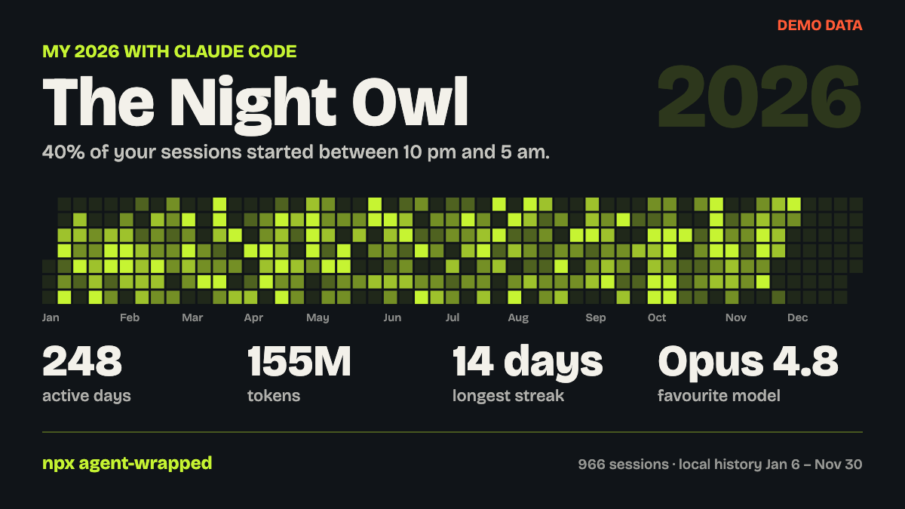
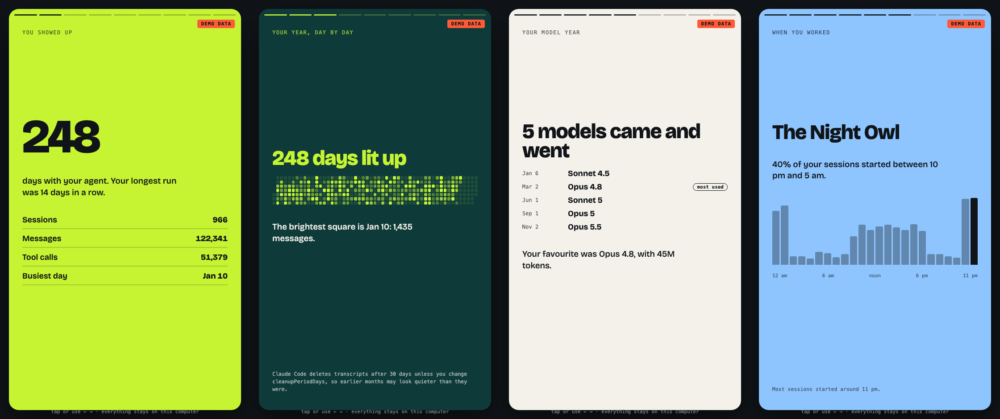

# agent-wrapped

**Your year with Claude Code, Spotify Wrapped style.** Made from the history already on your computer. Nothing is uploaded.

```bash
npx agent-wrapped
```



<sub>Demo data. Yours is made from your own history.</sub>

## What you get

A short story you tap through in your browser, then a card you can save as an image and post.



- **The days you showed up:** active days, sessions, messages, tool calls, your longest streak and your busiest day.
- **Your year as a heatmap:** every day of the year, like a GitHub contribution graph.
- **Tokens:** what your agent wrote and read, and how much context it re-read from cache.
- **Your model year:** every model you used, the day it first showed up, and your favourite.
- **When you worked:** sessions by hour, and a label for how you work: Night Owl, Early Bird, Orchestrator, Marathoner, Commander, Explorer, Builder, Researcher or Regular.
- **What your agent reached for:** top tools and the languages it edited most.
- **The big one:** your longest session, lines added and removed, and what your usage would cost at API prices.
- **Your card:** 1200×675, sized for X and LinkedIn. **Save image** downloads a PNG, **Copy text** copies a one-line summary.

The terminal gets a short version too:

```
  Your 2026 with Claude Code
  The Night Owl · 40% of your sessions started between 10 pm and 5 am.

  Active days     248  longest streak 14d
  Sessions        966
  Tokens          155.5M  + 9.2B re-read from cache
  Favourite model Opus 4.8
  Top tool        Bash
  Jan … Dec       ▆▆▅▇▅▇▆▇▆▇▇
```

## Privacy

- **Nothing leaves your computer.** agent-wrapped reads local files and writes one HTML file. That page makes no network requests: the font and the numbers are inside it.
- **The card shows totals only:** no prompts, no file names, no project names. A test checks that a prompt, a file path and a project name from your history never appear in the page.
- **The story slides name your top tools.** MCP tools are grouped by server name, for example "MCP · Supabase". If a server name is private, skip that slide when you share screenshots. The card itself never lists tools.

## Where the numbers come from

Claude Code keeps two kinds of local history, and agent-wrapped merges them:

| Source | What it has | How far back |
|---|---|---|
| `~/.claude/stats-cache.json` | Daily messages, sessions and tool calls, tokens per model, hours | Since your first session, but only up to the last time you ran `/stats` |
| `~/.claude/projects/**/*.jsonl` | Every session in detail: tools, files edited, active time, cost, lines changed | **30 days by default.** Claude Code deletes older transcripts |

Where both cover a day, the larger count wins, so nothing is counted twice. The page says which dates it is based on.

**Months missing?** Run `/stats` in Claude Code once (it refreshes the cache) and run agent-wrapped again. To keep transcripts for next year's Wrapped, set `"cleanupPeriodDays": 365` in `~/.claude/settings.json`.

**What the numbers mean:**
- **Tokens** are input plus output, the same count `/stats` uses. Context re-read from cache is shown separately because it is far larger.
- **Value at API prices** is Claude Code's own estimate of what the same usage would cost on the API. It is not what you paid on a subscription.
- **Longest session** is active time: pauses over 30 minutes are left out, so a session left open overnight does not count as 12 hours.

## Options

```
npx agent-wrapped --year 2026     a different year
npx agent-wrapped --out card.html where to write the page
npx agent-wrapped --no-open       write the page, don't open it
npx agent-wrapped --json          the numbers as JSON
npx agent-wrapped --demo          made-up data, to see what it looks like
```

If your Claude Code config lives somewhere else, set `CLAUDE_CONFIG_DIR`.

## As a Claude Code command

```bash
claude plugin marketplace add openyard-cloud/agent-wrapped
claude plugin install agent-wrapped@agent-wrapped
```

Then type `/wrapped` in any session.

## Requirements

Node 18 or newer. No dependencies.

## Not affiliated with Anthropic

agent-wrapped is an independent open-source project. Claude and Claude Code are products of Anthropic.

## License

MIT. The embedded font, [Bricolage Grotesque](https://github.com/ateliertriay/bricolage), is under the SIL Open Font License 1.1 ([fonts/OFL.txt](fonts/OFL.txt)).
